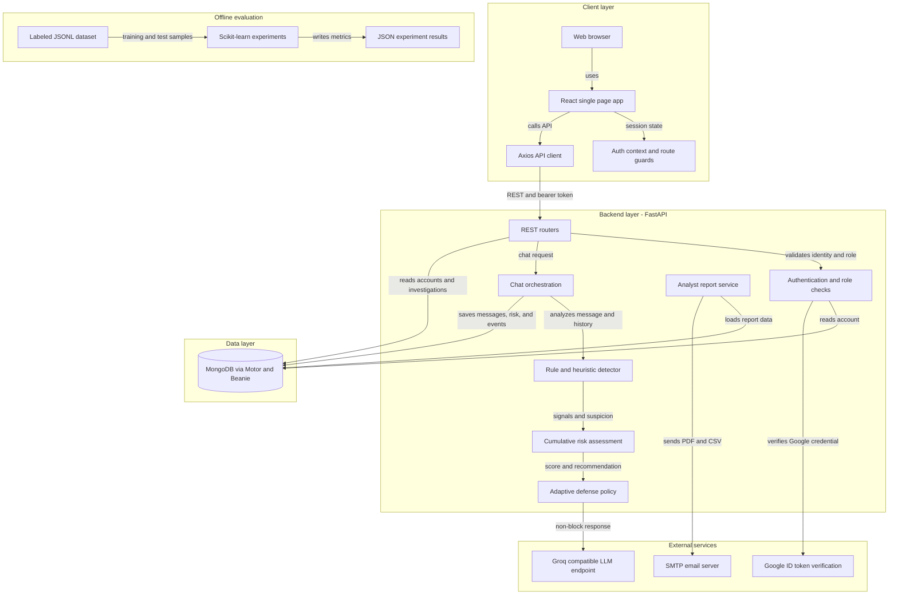
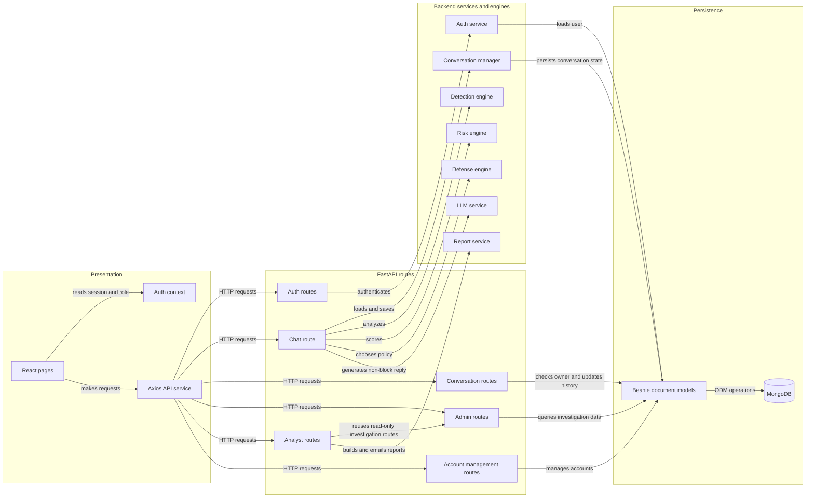
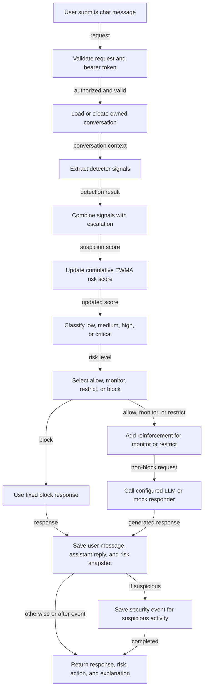
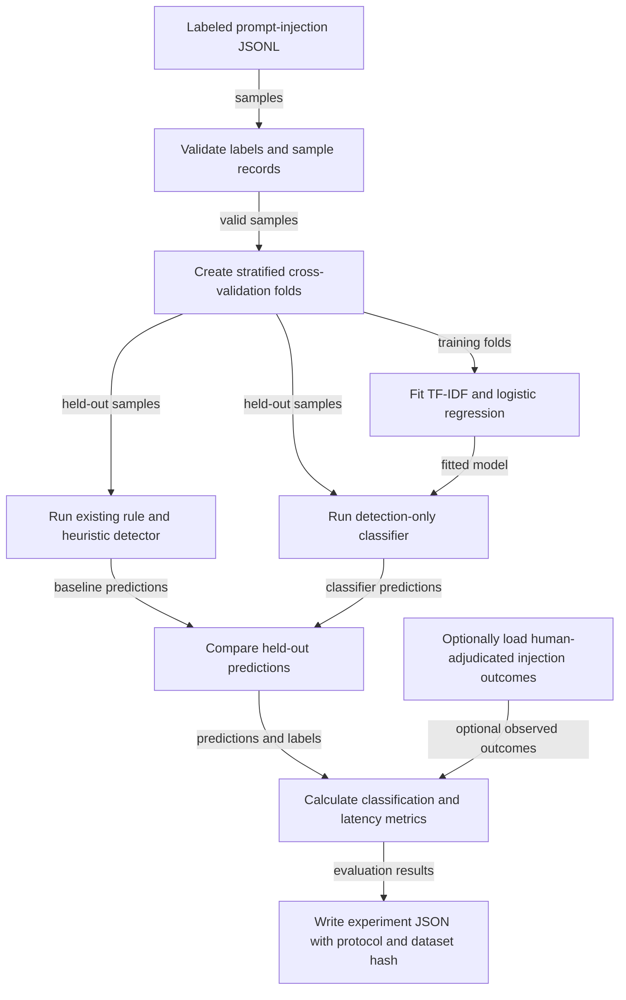

# PI-EWS Architecture and Methodology

PI-EWS is a prompt-injection early warning system with an interactive honeypot chat, adaptive risk-based defenses, and admin/analyst investigation tools. The diagrams below summarize the deployed application architecture and the live and offline analysis methodologies.

## Application Architecture

<!-- mermaid-checked: no \n, no em-dash/en-dash, no {} in labels, subgraphs are id["label"], arrows are -->|"label"|, all subgraphs closed by end, ids unique -->

### Technology Stack Summary

| Layer | Technology | Version declared | Purpose |
|---|---|---|---|
| Frontend | React, React DOM | `^19.3.1` | User, admin, and analyst interface |
| Frontend | React Router | `^7.18.6` | Client-side navigation and route guards |
| Frontend | Vite | `^8.3.6` | Development server and production build |
| Frontend | Axios | `^1.21.1` | REST requests and bearer-token attachment |
| Frontend | Tailwind CSS, Chart.js, Lucide React | Tailwind `^4.3.5`; Chart.js `^4.6.1` | Styling, dashboard charts, and icons |
| API | FastAPI, Uvicorn, Pydantic | Unpinned in requirements | REST API, validation, and ASGI serving |
| Persistence | MongoDB, Motor, Beanie | Motor `3.7.1`; Beanie `1.29.0` | Async document persistence |
| Authentication | python-jose, Passlib/bcrypt, Google Auth | Google Auth `>=2.28,<3` | JWTs, password hashing, and Google sign-in |
| Live analysis | Python regex and heuristic engines | Application code | Prompt-injection signals and risk-based policy |
| Offline evaluation | scikit-learn | `>=1.5,<2` | TF-IDF and logistic-regression experiment |
| Integrations | httpx, Google Identity, SMTP | httpx unpinned | LLM calls, identity verification, and report delivery |
| Reporting | ReportLab and Python CSV/email libraries | ReportLab `>=4.2,<5` | Analyst PDF and CSV reports |

### Data Storage and External Services

MongoDB stores users, conversations, and security events. Beanie models documents and Motor provides asynchronous database access; conversation messages and risk snapshots are embedded in conversation documents. The backend can call a Groq-hosted OpenAI-compatible chat-completions endpoint, verify Google ID tokens, and deliver analyst reports through SMTP. These integrations require environment configuration; the LLM service uses a canned mock responder when no usable LLM key is configured. The labeled dataset and experiment JSON results are local files, not live application collections.

### Key Architectural Decisions

- The FastAPI backend is the source of truth for identity, authorization, conversation ownership, risk decisions, and persisted analysis.
- The live chat pipeline uses rule and heuristic detection followed by cumulative EWMA risk scoring; the scikit-learn classifier is isolated to offline evaluation.
- Defense policy runs before response generation, so a block decision returns an override without calling the LLM.

## Component Relationships

<!-- mermaid-checked: no \n, no em-dash/en-dash, no {} in labels, subgraphs are id["label"], arrows are -->|"label"|, all subgraphs closed by end, ids unique -->

### Component Inventory

| Component | Layer | Type | Responsibility |
|---|---|---|---|
| React pages | Presentation | Pages/components | Login, chat, conversation, admin, and analyst screens |
| Auth context | Presentation | Context/provider | Holds the signed-in user and coordinates login state |
| Axios API service | Presentation | HTTP client | Calls API endpoints and attaches the JWT |
| Auth routes | API | Router | Registration, local login, Google login, and profile |
| Chat route | API/orchestration | Router | Coordinates detection, risk, defense, response, and persistence |
| Conversation routes | API | Router | Lists, reads, and hides the signed-in user's conversations |
| Admin routes | API | Router | Admin dashboard, analytics, events, and conversation investigation |
| Analyst routes | API | Router | Read-only investigation and report requests |
| Account management routes | API | Router | Admin-only account, role, and activation management |
| Auth service | Services | Authentication service | Password verification, JWTs, and role dependencies |
| Conversation manager | Services | Domain service | Creates sessions, appends messages, and updates risk snapshots |
| Detection engine | Analysis | Domain engine | Produces rule/heuristic injection signals |
| Risk engine | Analysis | Domain engine | Updates cumulative risk and maps it to a level/recommendation |
| Defense engine | Analysis | Domain engine | Selects allow, monitor, restrict, or block behavior |
| LLM service | Integration | External-service adapter | Calls configured LLM or supplies the mock response |
| Report service | Integration | Reporting service | Builds PDF/CSV attachments and sends SMTP email |
| Beanie document models | Data access | ODM models | Defines users, conversations, embedded messages, and events |
| MongoDB | Data | Document database | Persists application accounts and investigation records |

## Methodology

### Live Chat Analysis and Response

<!-- mermaid-checked: no \n, no em-dash/en-dash, no {} in labels, subgraphs are id["label"], arrows are -->|"label"|, all subgraphs closed by end, ids unique -->

The detector combines pattern matches, manipulation/override checks, context and encoding checks, phrase similarity, message anomaly scoring, and prior-turn escalation. Its signals are combined into an overall suspicion score; a turn is marked suspicious at `0.35` or higher. The risk engine updates the conversation score with an EWMA (`alpha=0.3`) for suspicious input and applies a gradual `0.05` decay for benign input. Risk bands are low below `0.3`, medium from `0.3`, high from `0.6`, and critical from `0.8`. The defense policy maps these levels to allow, monitor, restrict, and block; the response and risk metadata are persisted, with a security event recorded for suspicious turns.

### Offline Detector Evaluation

<!-- mermaid-checked: no \n, no em-dash/en-dash, no {} in labels, subgraphs are id["label"], arrows are -->|"label"|, all subgraphs closed by end, ids unique -->

The experiment script defaults to five stratified folds and a fixed seed of `42`. It compares the rule/heuristic baseline against the TF-IDF plus balanced logistic-regression detector on held-out, single-turn samples with empty conversation history; it does not call the LLM or apply defenses. Actual injection-success rate is reported only when human-adjudicated outcomes are provided; otherwise it is unavailable, and detector false negatives are reported as pass-through rate.

### Methodology Tools

| Activity | Tools |
|---|---|
| Web interaction | React, React Router, Axios, Vite |
| API and validation | FastAPI, Pydantic |
| Authentication | JWT, Passlib/bcrypt, Google Auth |
| Persistence | MongoDB, Motor, Beanie |
| Live prompt analysis | Python regular expressions and custom detection, risk, and defense engines |
| LLM response | httpx with configured OpenAI-compatible endpoint or mock service |
| Offline evaluation | scikit-learn, TF-IDF, logistic regression, stratified cross-validation |
| Reporting | ReportLab, Python CSV/email libraries, SMTP |
